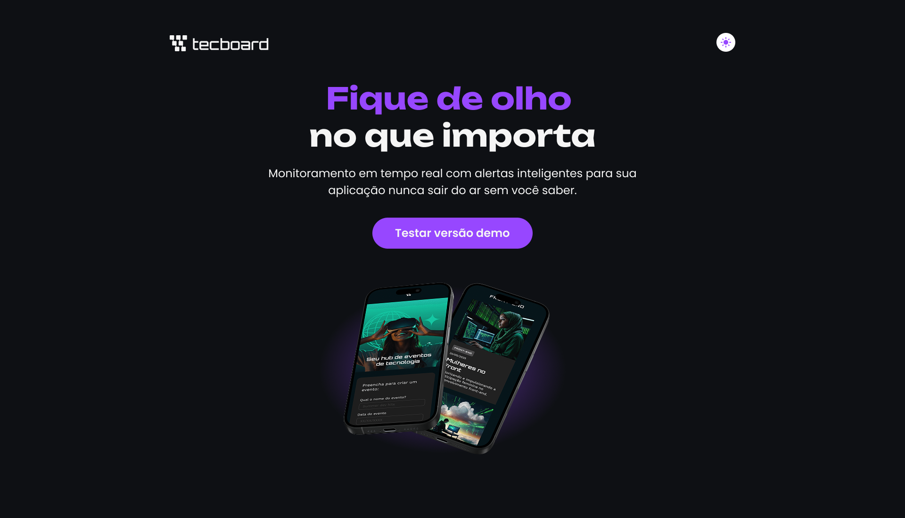

# Techboard

<p align="center">
  
</p>

# Techboard

Landing page desenvolvida durante o curso **HTML e CSS: Ambiente, Estrutura e Estilo**, da [Alura](https://www.alura.com.br/), com foco na construção de interfaces web utilizando HTML e CSS.

O projeto apresenta a interface de divulgação do Techboard, uma proposta de plataforma de monitoramento de aplicações, com uma página inicial que combina identidade visual, conteúdo institucional e elementos gráficos para apresentar a solução.

## Sobre o projeto

O Techboard foi desenvolvido como parte da minha jornada de aprendizado em desenvolvimento front-end. O objetivo foi aplicar na prática os fundamentos de HTML e CSS, explorando a estruturação de páginas, a organização dos arquivos e a estilização de interfaces.

A proposta visual utiliza uma identidade própria, com elementos gráficos, tipografia e composição de conteúdo para construir uma página de apresentação clara e organizada.

## Tecnologias utilizadas

- **HTML5:** estruturação do conteúdo e utilização de elementos semânticos.
- **CSS3:** estilização da interface e definição da apresentação visual.
- **Git:** controle de versão do projeto.
- **GitHub:** armazenamento e compartilhamento do código-fonte.

## O que foi desenvolvido

- Estruturação de uma página web com HTML.
- Construção de uma seção de apresentação do produto.
- Organização de títulos, textos, imagens e elementos de navegação.
- Aplicação de estilos CSS para compor a identidade visual.
- Utilização de imagens e recursos gráficos locais.
- Organização dos arquivos em diretórios separados.
- Prática de versionamento e publicação de código com Git e GitHub.

## Estrutura do projeto

```text
alura-techboard/
├── css/
│   └── style.css
├── fonts/
├── img/
├── favicon-techboard-roxo.svg
└── index.html
```

- `index.html`: estrutura principal da página.
- `css/`: arquivos responsáveis pela estilização.
- `fonts/`: recursos tipográficos utilizados no projeto.
- `img/`: imagens e elementos gráficos da interface.
- `favicon-techboard-roxo.svg`: ícone utilizado na identificação da página.

## Aprendizados

O desenvolvimento deste projeto contribuiu para consolidar conhecimentos fundamentais de front-end, especialmente em:

- Estrutura e semântica do HTML.
- Organização e legibilidade do código.
- Aplicação de estilos com CSS.
- Utilização de recursos visuais em páginas web.
- Organização de arquivos e diretórios.
- Controle de versão com Git e GitHub.

Além da implementação técnica, o projeto representa uma etapa prática do meu desenvolvimento como profissional de tecnologia, reforçando a importância de transformar os conhecimentos adquiridos em código.
